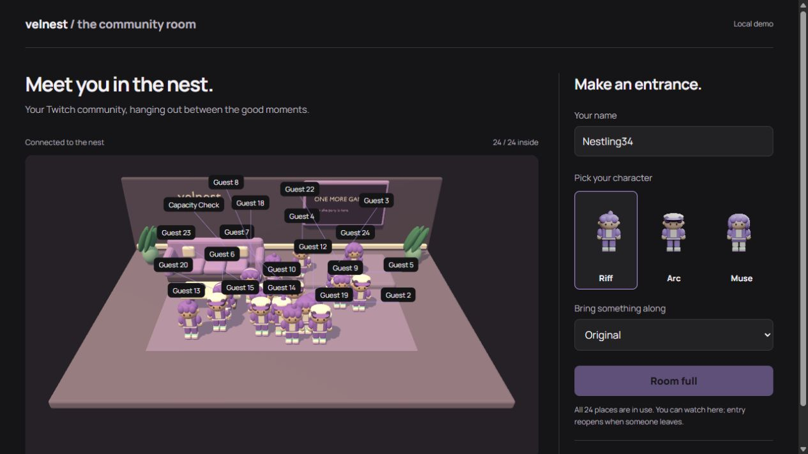

# Room capacity and crowded labels — October 28, 2026

The MVP admission ceiling is 24 avatars. It counts memberships rather than socket connections: observers can keep watching a full room, and the broadcaster can use management controls without occupying a character place. This is a fixed policy exported by the shared package, not a measured device-performance rating.

`pnpm test:capacity` opens 26 competing Socket.IO clients against an isolated real room server. Exactly 24 are admitted and two receive `room_full`. Every observed snapshot stays at or below the ceiling. The test also verifies a late OBS snapshot, an existing socket's repeated join, sofa reservation release on leave, successful retry by a previously denied observer and capacity release on disconnect. Existing real-mode authorization/moderation tests also pass; capacity checking does not replace entitlement checks.

## Browser verification

A loopback-only disposable fixture seeded 24 demo avatars with all three identity bases and the four accessory choices. The actual frontend displayed `24 / 24 inside`, disabled the entry button and explained continued spectating. Releasing a fixture guest changed the count to 23 and restored entry without reloading. The browser then entered and restored the count to 24. A second spectator verified the same full state and automatic recovery after the browser participant left.

The first crowded capture exposed labels moving above the scene. The new placement helper checks scene bounds, searches both axes, prioritizes the local participant/current reactions and omits a visual label if nearby space is exhausted. An accessible list retains all identities/states. Actual label dimensions are cached after text changes; leader lines point back to the original anchors.

After correction, DOM geometry checks found zero visible labels outside the scene on desktop and at a 390 px browser viewport (335 px scene width). The narrow view retained the local participant's label and all 24 roster entries. `pnpm test:labels` checks bounds and non-overlap for a deliberately dense 24-anchor layout at 820 and 335 px, plus malformed/offscreen/oversized input. This verifies label geometry; it does not prove a target frame rate.

## Other checks and limits

Typecheck, production build, twelve authentication/moderation tests and Taste source lint pass. React Best Practices review retained refs for transient rendering, functional updates for socket callbacks, stable effect cleanup, lazy scene boundaries and an explicit accessible roster.

The fixture is not part of the product and was removed after verification. No Twitch credentials or real viewers were used. Physical mobile performance, public traffic capacity, live Twitch authorization and the required Twitch/YouTube demonstration remain unverified.
