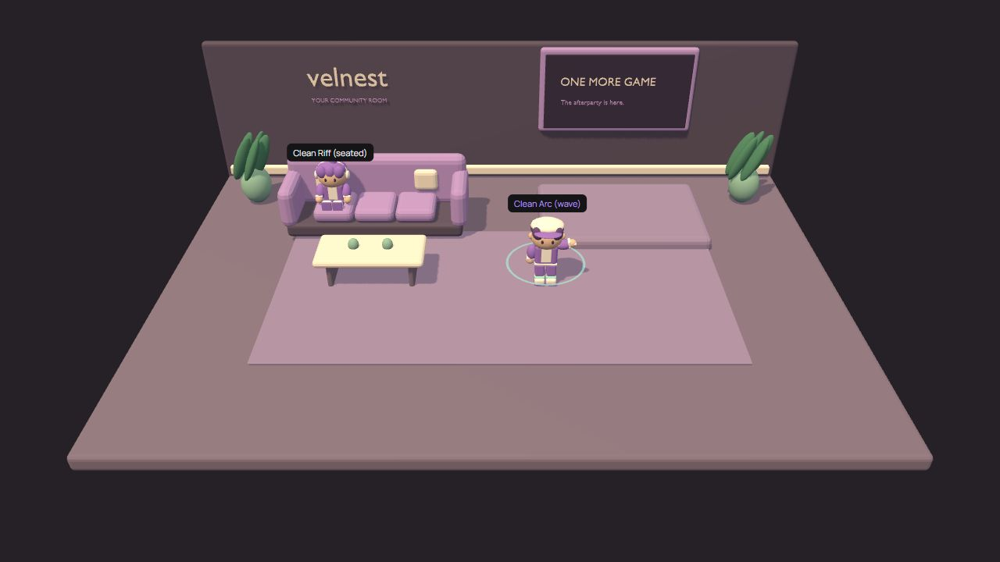

# Public repository reproduction — October 28, 2026

Verified public revision: `166a2aecb4039f50e1dbb8bfb26632c8343621ef` from https://github.com/MarZss03/velnest-twitch.

A shallow clone was created under `D:\Velnest - Twitch\downloads\verification\velnest-clean-20261028`. It had no prior generated build output or project node_modules. Node.js was 22.23.2 and pnpm was 11.25.0 on Windows. Installation used `pnpm install --frozen-lockfile --store-dir D:/.pnpm-store --cache-dir D:/.pnpm-cache`; all 129 dependency packages were reused from the existing package store. This verifies a new checkout with cached dependencies, not a disconnected installation or package-registry outage.

## Completed checks

- `pnpm typecheck` passed before generating shared/server build output.
- `pnpm build` passed for shared, server and web.
- `pnpm test:animations` passed against all three exported GLBs, including six clips, actual rig movement, seated/reduced-motion pose and idle restoration.
- `pnpm test:motion` passed finite transforms, expiry, effect cap, preference changes and cleanup.
- `pnpm test:room` passed all three pathfinding/bounds tests.
- `pnpm test:auth` passed all twelve simulated-provider HTTP/realtime tests, including broadcaster moderation.
- `pnpm test:seating` passed all three concurrent reservation and movement/standing/disconnect tests.

The default `.env.example` was copied to `.env` inside the verification checkout. An actual `pnpm dev` launched the shared compiler, server compiler/watch process, API and Vite frontend. To avoid the working project's occupied ports, this isolated run used environment overrides `PORT=3003`, `WEB_ORIGIN=http://localhost:5174`, `VITE_REALTIME_URL=http://localhost:3003`, and `MOCK_MODE=true`. Vite selected free port 5174 after detecting the working app on 5173.

## Browser evidence

Two controllers opened the clean checkout. **Clean Riff** joined as Riff with headphones; **Clean Arc** joined as Arc with a lightstick. Both controllers reported two participants. Riff reserved the left cushion, walked to it and reached the seated state. Arc's controller reported that cushion as taken, then triggered Wave. A third `?view=overlay` tab showed both names with the same seated/wave states and no controller chrome. The actual 3D scene and accessories rendered from the files in the public checkout.

The temporary runtime was stopped after verification. The working project retains its normal 5173/3001 setup.

## Scope limits

This is local demo-mode reproduction on Windows. It does not establish live Twitch authorization, a broadcast through OBS/Twitch, physical-phone networking/performance, macOS/Linux operation, every visual accessory/action/viewport permutation, or high-concurrency capacity. Those claims need their own evidence.
